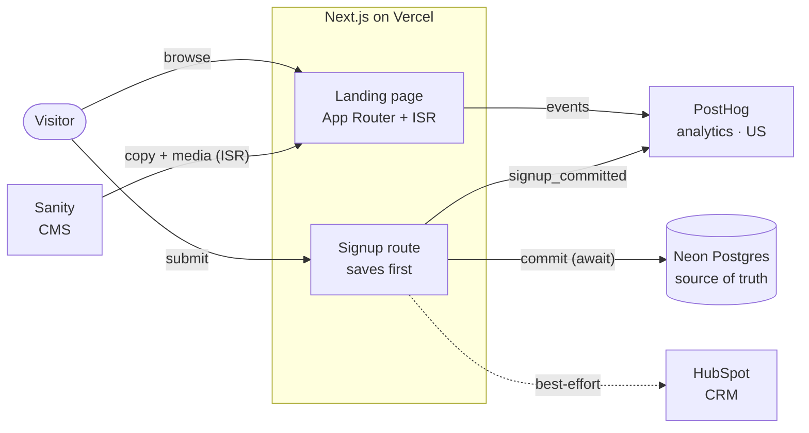
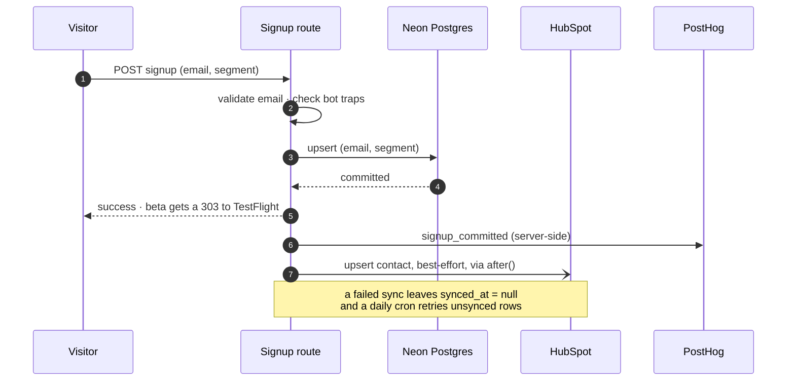

<h1 align="center">Starlight launch site</h1>
 
<p align="center">
  Check out the website here → <a href="https://www.trystarlight.app">www.trystarlight.app</a>
</p>

<p align="center">
  The launch site for <strong>Starlight</strong>, an AI day planner for days that don't come
  with a schedule.
</p>

Starlight is an AI day planner for freelancers, people running their own business, and anyone
else who sets their own hours. When nobody sets your day for you, every morning starts with a
long list and the same question: what's actually worth doing today? Starlight does that sorting
the way a good assistant would. You put everything on your plate in one place and tell it how
you like your day to run. It suggests a plan that fits, and you make the call.
 
This repo is the launch website for Starlight. It's one page that explains what Starlight is and
gives you two ways in. You can try the iOS beta today through TestFlight, or join the waitlist
for launch.
 
This project is also my attempt to get hands-on with wiring a CMS, a CRM and an analytics tool
together. Starlight needed a marketing website, so I thought it could be a good chance to try it
on something real while keeping the scope small.
 
The core of it is signups. Each one is saved to Postgres before anything else happens, so if the
CRM (HubSpot) is slow or down, or a lot of people sign up at once, the signup is still safe.

<p align="center">
  <a href="https://github.com/navdeepbeniwal16/starlight">The Starlight app Github repo</a>
</p>
 
## How it's built
 
I've built the site with an agentic coding workflow. I've made the calls on the architecture, the
data model, the API contracts and the overall design of each feature, and Claude Code has taken
care of the implementation. Every change has been checked against its ticket and covered by unit,
integration and end-to-end tests, which CI runs on every pull request and every push to `main`.
 
Before any code was written, I had listed the open questions in a
[`/wayfinder` issue](https://github.com/navdeepbeniwal16/starlight-site/issues/1) and worked
through each one in its own ticket: signup reliability, abuse defense, the content model,
analytics and privacy, and operations. All the decisions had then been compiled into one PRD,
published as the
[Launch Site v1 milestone](https://github.com/navdeepbeniwal16/starlight-site/milestone/1),
which became the build tickets.
 
Every ticket has gone through the same steps:
 
- It's had a spec first (the problem, the scope and the acceptance criteria), and it's only been
  picked up once that spec was ready.
- Each issue has had its own short-lived branch and one pull request that links back to it.
- Each pull request has been reviewed against the repo's standards and the ticket's spec, with
  CI running on every push.
- Every merge to `main` has deployed to Vercel automatically.
## Architecture
 
It's a Next.js app hosted on Vercel. The content copy comes from Sanity and analytics run on
PostHog. Signups are saved in Neon Postgres first for reliability and then copied over to a CRM
(HubSpot, in this case), with a daily cron job retrying any entries that didn't make it.
 
### Stack
 
| Area | Technologies |
|---|---|
| Framework and hosting | Next.js 16 (App Router), React 19, TypeScript (strict), Vercel |
| Styling | Tailwind CSS v4, styled-components, Fraunces, Inter and Caprasimo |
| Content (CMS) | Sanity, as one structured document, with the Studio built in at `/studio` |
| Source of truth | Neon Postgres, Prisma 7 (`@prisma/adapter-pg`) |
| CRM | HubSpot, best-effort, upserted by email, behind a swappable client |
| Analytics | PostHog (US cloud, no cookies) and Vercel Speed Insights |
| Testing | Vitest and Testing Library (unit, integration), Playwright (end to end) |
| CI/CD | GitHub Actions (five jobs), Vercel deploys when they pass |
 
### System
 

 
When someone visits, the App Router builds the page from the copy and media stored in Sanity,
using ISR. Publishing in Sanity fires a webhook that refreshes the page, so content changes go
live without a deploy.
 
When someone signs up, the request goes to a route handler that saves the row to Postgres and
responds straight away. HubSpot and the browser's analytics both run asynchronously, so they
can't slow the user down or break the signup. PostHog records the signup on the server after it's
saved, so the funnel numbers match the database.
 
### How a signup works
 

 
The route checks the email, checks the bot traps and upserts the row into Postgres. Once that's
committed, the signup is safe, and only then does the route respond. Beta signups get a `303`
redirect to TestFlight.
 
The HubSpot upsert runs after the response, using Next's
[`after()`](https://nextjs.org/docs/app/api-reference/functions/after), so a slow or failing CRM
doesn't hold anyone up. If the sync fails, `synced_at` stays null and a daily Vercel cron
retries every unsynced row. `POST /api/resync` does the same thing by hand.
 
`(email, segment)` is unique, so submitting twice just shows "already on the list", and the same
person can join both the beta and the waitlist.
 
### What else is wired in
 
- **Content.** The landing page is one structured document in Sanity, not a page builder. The
  code decides which sections exist and in what order, and Sanity holds the copy and media
  inside them. You edit it in the Studio at `/studio`, and every image needs alt text.
- **Analytics and privacy.** PostHog runs without cookies, so the site doesn't need a consent
  banner. A handful of events feed two conversion funnels, one for the beta and one for the
  waitlist.
- **Abuse defense.** A hidden honeypot field and an HMAC-signed time check catch most bots. When
  a bot trips one, it sees a normal success message, but nothing is saved. Both are tuned so
  real people, including screen reader users, don't set them off.
## Getting started
 
```bash
npm install            # postinstall runs `prisma generate`
cp .env.example .env   # set DATABASE_URL (Postgres) and SIGNUP_FORM_SECRET
npm run dev            # http://localhost:3000
```
 
Sanity, HubSpot and PostHog are all optional locally. Without them, the site uses its built-in
fallback copy and the integrations do nothing, so a Postgres URL is all you need.
 
## Environment variables
 
Every variable is documented in [`.env.example`](.env.example).
 
| Variable | Description |
|---|---|
| `DATABASE_URL` | Pooled Postgres connection for the app. **Required.** |
| `DIRECT_URL` | Direct (unpooled) connection for migrations. Optional locally, falls back to `DATABASE_URL`. |
| `SIGNUP_FORM_SECRET` | HMAC secret for each form's time check. The signup route won't accept submissions without it. |
| `TESTFLIGHT_URL` | Backup beta redirect URL. The main one lives in Sanity, in `siteSettings.testFlightUrl`. |
| `NEXT_PUBLIC_SANITY_PROJECT_ID` | Sanity project ID. If unset, the site uses its fallback copy. |
| `SANITY_REVALIDATE_SECRET` | Shared secret for the publish webhook (`POST /api/revalidate`). |
| `HUBSPOT_ACCESS_TOKEN` | CRM token, plus a list ID for each segment. If unset, nothing is sent to HubSpot. |
| `CRON_SECRET` | Bearer token that protects the cron job and `/api/resync`. |
| `NEXT_PUBLIC_POSTHOG_KEY` | PostHog project key (US cloud). If unset, analytics are off. |
 
## Scripts
| Script | What it does |
|---|---|
| `npm run dev` | Start the dev server |
| `npm run build` | Run pending migrations (if a database is set), then `next build` |
| `npm start` | Serve the production build |
| `npm run lint` | ESLint |
| `npm run typecheck` | Generate route types, then `tsc --noEmit` |
| `npm run test` | Vitest unit tests |
| `npm run test:integration` | Integration tests (needs Postgres via `DATABASE_URL`) |
| `npm run test:e2e` | Playwright end-to-end tests |
 
## Deployment
 
Vercel's GitHub integration builds a preview for every pull request and deploys to production
when something merges into `main`. `main` is protected by the CI checks, so a failing run can't
ship, and there's no custom deploy code.
 
Each deploy runs its own migrations. `npm run build` runs `prisma migrate deploy` on the direct
connection before `next build`, so after every deploy the database matches the committed
migrations. Builds without a database (local, CI, or a fork's preview) skip that step and still
succeed.
 
CI (`.github/workflows/ci.yml`) runs five jobs on every pull request and every push to `main`:
**lint**, **type-check**, **unit**, **integration** (the signup route against a throwaway
Postgres container) and **e2e**.
 
A few things live in dashboards, not in this repo: the Vercel project link, the env vars above,
the Sanity project and its publish webhook, the PostHog project and its two funnels, and branch
protection on `main`.